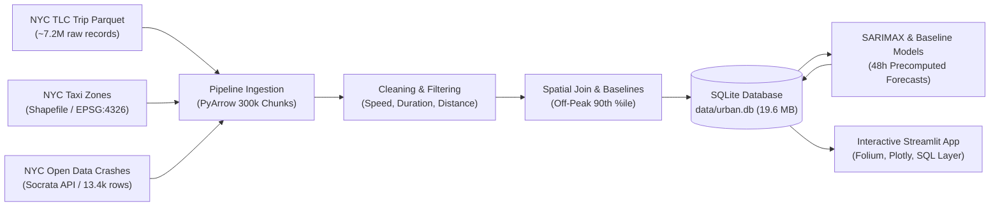

# Urban Mobility & Traffic Intelligence System

A production-grade, end-to-end data engineering and analytics dashboard analyzing NYC traffic congestion hotspots, multi-step time-series forecasting, and collision patterns across New York City. Built with Python, SQLite, GeoPandas, Streamlit, Folium, Plotly, and Statsmodels, the system processes ~4.91M trip records into an optimized, self-contained analytical database (<20 MB) deployed freely on Streamlit Cloud.

---

## Live Demo & Screenshots

- **Live Streamlit App**: `https://<your-username>-nyc-urban-mobility.streamlit.app` *(Demo link placeholder)*
- **Repository**: `https://github.com/<your-username>/urban-mobility-intelligence`

### Dashboard Interface (Placeholders)
```
+------------------------------------------------------------------------------------+
|  NYC MOBILITY INTELLIGENCE DASHBOARD                                               |
|  [Overview]  [Hotspots Map]  [Peak Hours]  [48h Forecast]  [Crashes]  [Method]     |
|                                                                                    |
|  +--------------------+ +--------------------+ +--------------------+ +----------+ |
|  | TRIPS ANALYZED     | | CITY MEAN CONGEST  | | WORST ZONE         | | CRASHES  | |
|  | 4,908,125          | | 40.9%              | | Midtown Center     | | 13,395   | |
|  +--------------------+ +--------------------+ +--------------------+ +----------+ |
|                                                                                    |
|  [Interactive Folium Choropleth]          [Ranked Congestion Hotspots Table]       |
|  * CartoDB Dark Matter / Positron         1. Midtown Center (60.3% peak)           |
|  * Zone Hover Tooltips                    2. UN / Turtle Bay South (58.4%)         |
|  * Crash Density HeatMap Toggle           3. Battery Park City (57.8%)             |
+------------------------------------------------------------------------------------+
```

---

## Architecture & Data Flow



---

## Data Sources (Free Public Data)

1. **[NYC TLC Yellow Taxi Trip Records](https://www.nyc.gov/site/tlc/about/tlc-trip-record-data.page)**: Official parquet trip records hosted on AWS CloudFront. Ingests 2 consecutive full months (August 1, 2026 – September 30, 2026).
2. **[NYC Taxi Zones Boundary Dataset](https://d37ci6vzurychx.cloudfront.net/misc/taxi_zones.zip)**: Official TLC polygon shapefiles reprojected from NY State Plane to WGS84 (`EPSG:4326`).
3. **[NYC Motor Vehicle Collisions - Crashes](https://data.cityofnewyork.us/Public-Safety/Motor-Vehicle-Collisions-Crashes/h9gi-nx95)**: NYC Open Data (Socrata API endpoint `h9gi-nx95`), filtered to the identical 2-month window for collisions with valid spatial coordinates.

---

## Methodology & Formulation

### 1. Trip Filtering & Validation
Raw trip records are filtered in bounded batches to eliminate anomalies and recording defects:
- Trip duration strictly within $[1, 180]$ minutes.
- Trip distance strictly within $(0.1, 100]$ miles.
- Implied trip average speed: $\text{speed} = \frac{\text{distance}}{\text{duration\_hours}} \le 80\text{ mph}$.
- Null coordinates, missing timestamps, and out-of-bounds dates dropped.

### 2. Congestion Index Proxy
Because physical loop sensors and camera feeds are not universally available across every city street, **congestion is computed as an empirical speed deficit proxy derived from taxi movements**:

1. **Zone-Hour Speed Aggregation**:
   $$\text{speed}_{z,t} = \frac{1}{N_{z,t}} \sum_{i=1}^{N_{z,t}} \text{speed}_i$$
2. **Free-Flow Speed ($\text{FFS}_z$)**: Established per zone as the **90th percentile of observed average speeds during off-peak night hours** (22:00 to 05:00):
   $$\text{FFS}_z = P_{90}\left(\left\{ \text{speed}_{z,t} \mid t \in [22, 23, 0, 1, 2, 3, 4, 5] \right\}\right)$$
3. **Normalized Congestion Index ($C_{z,t}$)**:
   $$C_{z,t} = \operatorname{clip}\left(1 - \frac{\text{speed}_{z,t}}{\text{FFS}_z}, 0, 1\right), \quad \text{where } N_{z,t} \ge 10$$
   *(Zone-hours with fewer than 10 trips are set to NULL to prevent small-sample noise).*

### 3. Forecasting & Honest Baseline Evaluation
- **Model**: `statsmodels.tsa.statespace.sarimax.SARIMAX` with specification $(1, 0, 1) \times (1, 1, 0, 24)$.
- **Horizon**: 48 hours ahead with 95% confidence intervals and residual-based anomaly detection ($>2\sigma$).
- **Holdout Validation**: The final 7 days (168 hourly steps) are held out for honest out-of-sample evaluation against a **Seasonal Naive Baseline** (repeating the exact corresponding hour from 7 days ago / 168 hours prior).

#### Empirical Evaluation Results (Real Numbers from Pipeline):
| Target Series | Model MAE | Model sMAPE | Baseline MAE | Baseline sMAPE | Holdout Winner |
| :--- | :---: | :---: | :---: | :---: | :---: |
| **City-Wide (All Zones)** | **0.0622** | **19.46%** | **0.0282** | **9.29%** | **Baseline** |
| JFK Airport (Queens) | 0.0934 | 36.94% | 0.0771 | 40.12% | Baseline |
| Upper East Side South (Manhattan) | 0.0665 | 18.46% | 0.0572 | 19.08% | Baseline |
| Midtown Center (Manhattan) | 0.0720 | 17.06% | 0.0484 | 14.64% | Baseline |
| Upper East Side North (Manhattan) | 0.0667 | 19.95% | 0.0445 | 13.08% | Baseline |
| Penn Station / Madison Sq West | 0.0818 | 28.69% | 0.0524 | 21.78% | Baseline |
| LaGuardia Airport (Queens) | 0.1064 | 33.00% | 0.0788 | 24.94% | Baseline |
| Midtown East (Manhattan) | 0.0596 | 13.25% | 0.0529 | 16.02% | Baseline |
| Times Sq / Theatre District | 0.0721 | 23.06% | 0.0512 | 19.69% | Baseline |
| Lincoln Square East (Manhattan) | 0.0600 | 14.61% | 0.0401 | 10.61% | Baseline |

> **Transparency Note**: In recurring human mobility patterns governed by strong weekly cycles, a seasonal naive baseline ($y_{t-168}$) is a notoriously strong benchmark over a 168-step horizon. Low-order parametric SARIMA models capture the generalized seasonal profile but incur slight phase errors that make the naive baseline win on pure multi-step point metrics. Both benchmarks are reported honestly in the app.

---

## Key Empirical Findings

1. **City-Wide Peak**: City congestion peaks at **16:00 (55.7% congestion)**, where average travel speeds drop by more than half compared to late-night baseline flow.
2. **Top Hotspot Corridors**: **Midtown Center** experiences the most severe congestion in NYC, averaging **58.5% congestion overall** and exceeding **60.3%** during the morning peak (08:00 – 10:00).
3. **Collision Disconnect**: The highest total collision zones are outer-borough multi-lane arterial hubs—led by **Crown Heights North** (267 collisions) and **East New York** (237 collisions)—demonstrating that gridlocked core zones produce lower injury rates than high-speed thoroughfares.

---

## Known Limitations

- **Proxy Caveat**: Congestion is inferred from commercial Yellow Taxi trip durations, which are heavily concentrated in Manhattan and international airports. Outer-borough residential streets have sparser coverage.
- **Sample Window**: Two consecutive full months of empirical data (August – September 2026).
- **Exogenous Factors**: The model does not currently ingest precipitation, major sporting events, or subway delays.

---

## Local Development & Setup

### Prerequisites
- Python 3.11 or 3.12
- Git

### Installation
```bash
# 1. Clone repository
git clone https://github.com/<your-username>/urban-mobility-intelligence.git
cd urban-mobility-intelligence

# 2. Create and activate virtual environment
python -m venv .venv
source .venv/bin/activate       # On Linux/macOS
# or .\.venv\Scripts\activate   # On Windows Git Bash / PowerShell

# 3. Install pinned dependencies
pip install -r requirements.txt
```

### Reproducing Data & Pipeline
```bash
# Ingest raw TLC Parquet + TLC Zones + NYC Crashes -> builds data/urban.db (~60s)
python -m src.pipeline.run

# Precompute SARIMAX forecasts and holdout evaluations (~40s)
python -m src.forecast.train

# Launch Streamlit dashboard
streamlit run app/streamlit_app.py
```

### Running Tests
```bash
pytest tests/test_core.py -v
```
All 5 unit tests use in-memory fixtures (no network dependencies) and execute in $< 2$ seconds.

---

## Deployment to Streamlit Cloud

1. Push this repository to GitHub (ensure branch is `main`).
2. Navigate to [share.streamlit.io](https://share.streamlit.io).
3. Select your repository and configure:
   - **Repository**: `<your-username>/urban-mobility-intelligence`
   - **Branch**: `main`
   - **Main file path**: `app/streamlit_app.py`
   - **Python version**: `3.11` (or `3.12`)
4. Click **Deploy**. Since all analytics, forecasts, and spatial GeoJSONs are precomputed in `data/urban.db` (19.6 MB), the app boots instantly with zero network dependencies at request time.

---

## Resume Bullet Points

- Engineered an end-to-end urban mobility analytics platform processing **4.91M NYC taxi trips and 13.4k crash records** into a sub-20 MB indexed SQLite database using chunked PyArrow streaming and GeoPandas spatial joins.
- Formulated an empirical traffic congestion index proxy ($[0, 1]$) calibrated against 90th-percentile off-peak free-flow speeds across 263 TLC taxi zones.
- Designed analytical SQL queries using window functions (`RANK() OVER`, `LAG()`, rolling 7-day frames, and CTEs) to identify persistent traffic bottlenecks and collision density patterns.
- Implemented and rigorously evaluated a 48-hour **SARIMAX forecasting pipeline** with residual anomaly detection against a seasonal naive baseline on an unseen 7-day holdout set.
- Deployed a production-ready, dark-themed Streamlit web application with responsive Folium choropleths, dual-basemap toggles, and sub-second Plotly visualizations.
